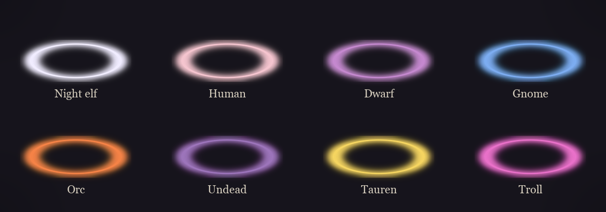

# Stillwater



### A calmer screen: action bars that rest faint until you need them, procs as a ring of light at your feet, and quiet chat.

## What you get

- **Bars that step back.** Your action bars sit at 35% out of combat and 75% in combat, and come up to full the moment
  the mouse is over them. The micro menu and bags sit fainter still, at 20%. Edit Mode shows everything at full.
- **Buttons you can still find.** A thin pale outline round each filled button keeps its own opacity, so a quiet bar
  never vanishes; empty slots get none. A button lit by a proc keeps its glow at full strength.
- **Procs where you're already looking.** When Blizzard lights a proc glow, a flat ring of light opens on the ground
  below your character, in your race's homeland colour, breathes while the proc is up and closes when it goes. The
  glowing button still says which spell. The eight original races each have their own colour; any other race gets a
  pale white.
- **A ripple for Manabloom players.** With Manabloom loaded, one ripple goes out across the ground when its bramble
  reaches the top step. Earned, rare, then gone.
- **Quiet chat** (this was the Hush addon). The chat tabs and buttons hide and the chat backgrounds clear, while
  whispers still show and fade and Enter still opens the edit box. If you used Hush, turn it off: Stillwater does its
  job now.
- **A tidier minimap corner.** The new-mail icon is drawn the calendar's size, just right of it. Blizzard's durability
  doll moves from under the minimap to the bottom-right corner and stays faint until the mouse is over it. Shift-drag
  either one to move it.
- **One small panel.** A button on the minimap's edge (the ring, in your race's colour) opens the options: Stillwater,
  Quiet chat and Button outlines as toggles, and sliders for how faint the bars sit at rest and in combat. Drag the
  button to move it round the edge.

## Why

The default screen keeps every action bar at full strength all the time, along the bottom edge, and keeps chat tabs,
buttons and backgrounds over the world even when nobody is talking. In a busy fight, things at the edge of the screen
stop being seen (Lavie, 1995), and a busy display pulls the eyes off the world (Wickens & Alexander, 2009). Stillwater
keeps little on screen and puts the one moment that matters, a proc, on the ground near your character, said by shape
and motion as well as colour. It never tells you what to press next.

## Download

1. Download `Stillwater-vX.Y.Z.zip` from the [latest release](https://github.com/rainbowpusheenthe3rd/stillwater/releases/latest).
2. Unzip the `Stillwater` folder into `World of Warcraft\_forever_\Interface\AddOns`.
3. Log in. The bars go quiet on their own; click the minimap button for the options.

Commands (`/still` or `/stillwater`): `/still on | off`, `/still rest | fight | edges | border <0-1>` (bars out of
combat, in combat, micro menu and bags, button outlines), `/still y <px>` and `/still size <px>` (the ring),
`/still chat [on | off]` (or `/hush`), `/still mail reset`, `/still doll <0-1> | reset`, `/still test` (shows the
ring, then a ripple), `/still probe`.

<details>
<summary>Art and development</summary>

The ring is drawn in code by `tools/stillwater_art.py`: a thin bright core inside a wide soft glow, white, so the
addon can tint it. The race colours are Homeland's palette, copied in; Stillwater needs neither Homeland nor
Manabloom, and listens on Manabloom's `ManabloomEvents` only if it is there.

On login a small probe records which of Blizzard's combat tools this client has and counts proc glows (`/still probe`),
so later versions are built on what the client really allows. The research behind the design is in
[docs/research/references.md](docs/research/references.md).

For development, link the game's folder to this repo (a directory junction, run once):

```powershell
New-Item -ItemType Junction -Path "<WoW folder>\_forever_\Interface\AddOns\Stillwater" -Target "<this repo>"
```

`tests/` holds its smoke tests (`uv run --with lupa python tests/<file>.py`).

</details>

<p align="center"></p>
